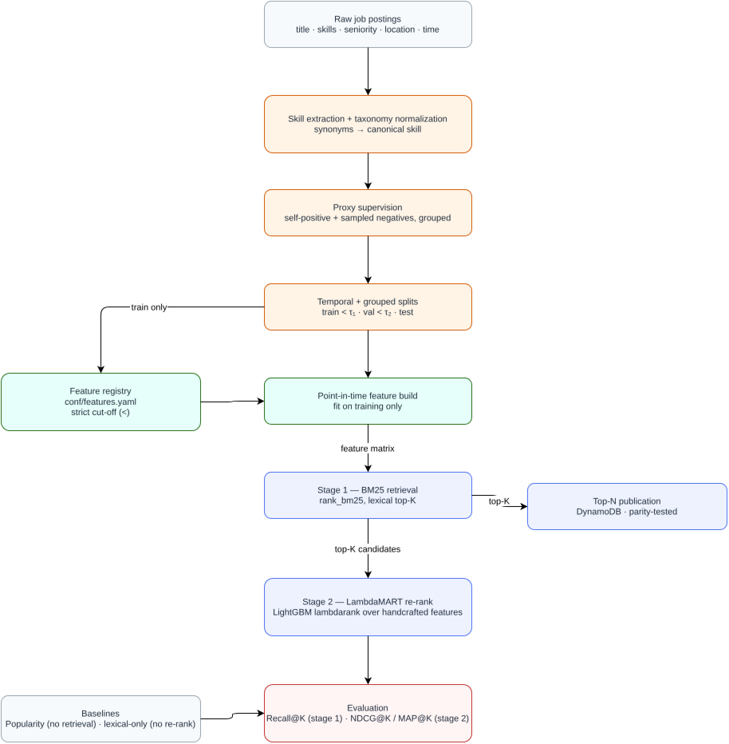
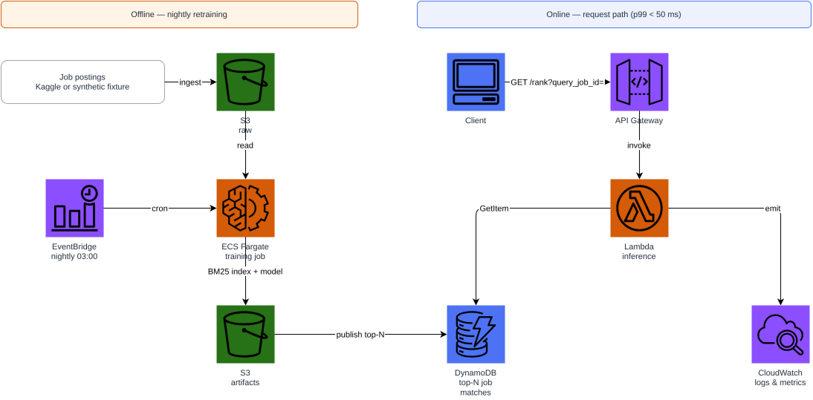

# linkedin-skills-job-matching

Classical, fully non-neural two-stage retrieve-then-rank recommender for
matching candidate skill profiles to job postings: **BM25 lexical retrieval**
(stage 1) followed by **LambdaMART (LightGBM `lambdarank`) re-ranking** on
handcrafted, point-in-time-safe features (stage 2).

Full write-up: [`paper/main.pdf`](paper/main.pdf).

## Why classical, two-stage retrieval?

Before dense neural retrieval, production search and recommendation systems
were built on exactly this pattern: a cheap lexical/statistical retriever
(BM25) narrows a huge catalogue down to a shortlist, and a boosted-tree
ranker — trained on explicit, auditable features — reorders that shortlist
for quality. This project reproduces that pipeline end to end for the
LinkedIn skills/job-matching domain, with **no neural networks and no
learned embeddings anywhere in the stack**: stage 1 is `rank_bm25`
(pure-Python Okapi BM25), stage 2 is `lightgbm` with
`objective="lambdarank"`.

## The problem, honestly

The underlying data is job postings with required skills — there is no real
candidate profile and no real candidate-job interaction log. Rather than
pretend otherwise, this project builds and documents a self-supervised
proxy: each posting's own (partially resampled) skill set stands in for a
matching candidate profile, paired against other postings as negatives,
grouped for LightGBM's LTR objective. See `paper/sections/02-dataset.tex`
for the construction and its explicit limitations.

## Quickstart

```bash
pip install -e ".[dev]"
python scripts/download_data.py --synthetic   # or --kaggle with KAGGLE_USERNAME/KAGGLE_KEY set
pytest -q
ruff check src tests scripts

python -m recommender.cli train
python -m recommender.cli evaluate --partition test --k 10
python -m recommender.cli rank --query-job-id 1 --k 5
```

## Architecture

**Modelling pipeline** — raw postings to a re-ranked list, with the
point-in-time feature contract and the two non-neural baselines that make
the two-stage contribution measurable:



**Serving infrastructure** — offline nightly retraining (Floci/AWS: S3,
ECS Fargate, EventBridge) publishing precomputed top-N matches to DynamoDB,
read by a Lambda behind API Gateway on the request path:



## Evaluation protocol

- **Stage 1 Recall@K** — fraction of queries for which the true
  profile-job pair survives into the BM25 top-K candidate set (retrieval
  coverage alone, independent of ranking).
- **Stage 2 NDCG@K / MAP@K** — computed on the LambdaMART-re-ranked top-K
  from stage 1, using the proxy relevance label, which decomposes the
  end-to-end number into a coverage term and a ranking-quality term.
- **Baselines** — a *popularity* baseline (raw skill-overlap count, no
  retrieval at all) and a *lexical-only* baseline (BM25 top-K, no
  re-ranking), evaluated with the exact same metrics for a fair comparison.

<!-- RESULTS:START -->
| Model | Recall@10 | NDCG@10 | MAP@10 |
|---|---:|---:|---:|
| Popularity | 0.3733 | 0.2232 | 0.1769 |
| LexicalOnly | 0.9933 | 0.9128 | 0.8861 |
| TwoStage | 0.9933 | 0.9556 | 0.9422 |
<!-- RESULTS:END -->

(On the synthetic fixture, test partition, K=10; regenerate with
`python scripts/export_results_table.py`.)

## Features

Every feature is declared in `conf/features.yaml`, validated against its
implementation by `recommender.features.registry.validate_registry`, and
documented with a required rationale. Point-in-time features
(`candidate_job_trailing_postings`, `query_candidate_recency_gap_days`) are
fitted on the training partition only, with a strict `<` cut-off enforced
and covered by dedicated leakage tests in `tests/test_features_leakage.py`.
See `paper/tables/features.tex` (embedded in the technical report) for the
full, generated table.

## Repository layout

```
conf/features.yaml          declarative feature specification
data/                        local datasets (gitignored, synthetic by default)
docs/                        architecture diagrams (draw.io + rasterized SVG/PNG)
paper/                       LaTeX technical report
scripts/                     data generation, feature export, diagram export
src/recommender/             library code (data, features, models, evaluation, serving)
terraform/                   Floci-backed (or real AWS) serving infrastructure
tests/                       pytest suite, including dedicated leakage controls
```

## Infrastructure (Floci, free and local)

```bash
docker compose up -d                 # Floci AWS emulator on :4566
cd terraform
terraform init
terraform validate
terraform apply -auto-approve
terraform destroy -auto-approve
cd .. && docker compose down
```

The same Terraform targets real AWS with `terraform apply -var
use_floci=false -var aws_region=us-east-1`. See `terraform/README.md` for
the full design notes and cost breakdown (free on Floci; well under
$1/month on real AWS at portfolio traffic).

## Building the paper

```bash
cd paper
make docker   # or `make` with a local TeX Live install
```

## Testing

```bash
pytest -q                          # schema, leakage, parity, models, serving
ruff check src tests scripts
terraform -chdir=terraform init -backend=false && terraform -chdir=terraform validate
```

## License

MIT, see `LICENSE`.
